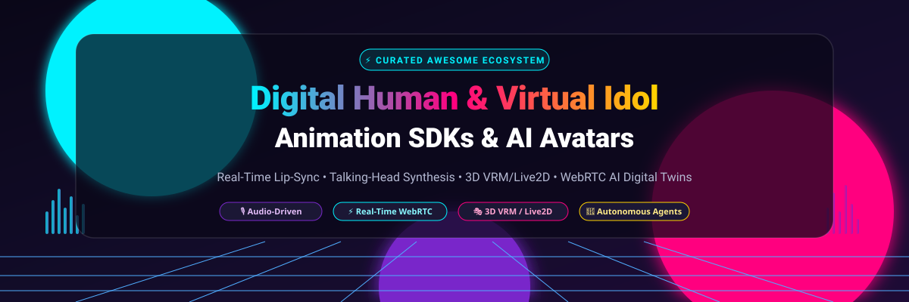
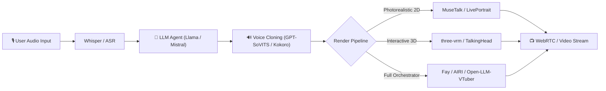

  

# 🎭 Awesome Digital Human & Virtual Idol Animation SDK 🌟

*A definitive, curated directory of cutting-edge **SaaS platforms**, **developer APIs**, and **open-source AI repositories** for photorealistic digital humans, 3D VRM & Live2D virtual idols, real-time audio-driven lip-sync, talking-head synthesis, and autonomous conversational video avatars.*

---

## 📌 Table of Contents

- [🌐 Sector Overview & Market Dynamics](#-sector-overview--market-dynamics)
- [🏢 SaaS & Hosted Platforms](#-saas--hosted-platforms)
- [💻 Open-Source GitHub Repositories](#-open-source-github-repositories)
- [🛠️ Architectural Design Patterns](#️-architectural-design-patterns)
- [🤝 How to Contribute](#-how-to-contribute)
- [💖 Support & Sponsorship](#-support--sponsorship)
- [📈 Star History](#-star-history)
- [⚖️ Disclaimer & Ethical Use](#️-disclaimer--ethical-use)

---

## 🌐 Sector Overview & Market Dynamics

The global market for **interactive digital humans, virtual idols, and conversational AI avatars** is undergoing exponential expansion. Valued at roughly **$6.3B to $8.0B in 2025–2026**, the sector is projected to reach between **$26B and $46B+ by 2030** (with broader synthetic avatar media, virtual streamers, and AI video synthesis exceeding $250B+), driven by a compound annual growth rate (**CAGR**) of ~35%–45%.

The sector structure is **moderately fragmented**: 
- **Foundational Infrastructure**: Deep-learning pipelines (ASR, TTS, LLMs, diffusion models) and real-time graphics runtimes (Unreal Engine 5, Unity, WebGPU, WebRTC) are dominated by hyperscalers and GPU giants like NVIDIA, Microsoft, Google, Meta, and Epic Games.
- **Application & SDK Tier**: Highly dynamic, product-led startups actively capture vertical market niches—spanning enterprise video localization, real-time conversational customer support agents, VTuber streaming companions, and multimodal game NPC behaviors.

---

## 🏢 SaaS & Hosted Platforms

Enterprise-ready cloud platforms and developer APIs for digital presenters, conversational agents, and interactive WebRTC video avatars, sorted in descending order of company valuation / annual recurring revenue:

| Platform | 📊 Valuation / Scale | 💳 Starting Price | 🎁 Free Tier / Trial Limit | 🚀 Core Capabilities |
| :--- | :--- | :--- | :--- | :--- |
| **[Synthesia](https://synthesia.io)** | Valuation: ~$4.0B *(ARR: ~$150M+)* | **$19/mo** *(or $14/mo billed annually)* for Starter | **Free plan**: ~10 mins video/dubbing per mo (~500–1,200 credits), 9 stock avatars, watermarked exports | Enterprise AI video & avatar platform with 140+ languages, studio digital twins, SCORM export, and brand kits. |
| **[HeyGen](https://heygen.com)** | Valuation: ~$500M+ *(ARR: ~$200M+)* | **$29/mo** *(or $24/mo billed annually)* for Creator | **Free plan**: 3 videos per month (max 1 min per video), watermarked, 30+ languages | Cloud AI digital human & streaming avatar API with real-time WebRTC, voice cloning, and interactive avatar SDKs. |
| **[Inworld AI](https://inworld.ai)** | Valuation: ~$500M *(Funding: ~$120M+)* | **$25/mo** for Creator *(Pay-as-you-go after allowances)* | **Free tier**: ~70 free TTS mins/mo and ~400 free STT mins/mo for prototyping | Real-time AI character & NPC behavior engine with multimodal voice, dynamic emotional state graphs, and Unreal/Unity SDKs. |
| **[Tavus](https://tavus.io)** | Valuation: ~$250M+ *(Funding: ~$66M)* | **$22/mo** for Starter developer plan | **Free tier**: ~20–25 conversational video mins/mo, 1 active concurrent session | Real-time multimodal conversational video API delivering low-latency photorealistic digital humans with vision perception. |
| **[Soul Machines](https://soulmachines.com)** | Valuation: ~$250M–$500M *(Acquired by AppDirect; Funding: ~$135M)* | **$13/mo** for Solo Studio plan | **Free trial**: 14-day free trial on Studio tier with limited conversation minutes pool | Biologically inspired 3D digital people & Experiential AI platform for interactive brand ambassadors and digital workforces. |
| **[D-ID](https://d-id.com)** | Valuation: ~$100M–$250M *(ARR: ~$10M–$34M)* | **$4.70/mo** *(billed annually)* / **$29/mo** for Pro | **Free trial**: 14-day free trial with ~3 minutes of video generation credits, watermarked | Cloud digital people and streaming avatar API animating still photos and 3D portraits with LLM integrations. |
| **[DeepBrain AI](https://deepbrain.io)** | Valuation: ~$100M+ *(Funding: ~$52M Series B)* | **$29/mo** *(or $24/mo billed annually)* for Personal | **Free plan**: 3 free videos (up to 3 minutes each) upon signup, watermarked | Cloud conversational avatars and AI Studios generating 2D/3D custom digital twins and real-time kiosk presenters. |
| **[Hour One](https://hourone.ai)** | Valuation: ~$100M–$250M *(ARR: ~$10M–$11.5M)* | **$30/mo** for Lite plan | **Free trial**: 3 minutes of free video creation with restricted avatar library | Enterprise virtual presenter and AI video platform turning text and structured scripts into photorealistic presentations. |
| **[Colossyan](https://colossyan.com)** | Valuation: ~$80M–$150M *(Funding: ~$28M)* | **$19/mo** *(billed annually)* / **$27/mo** for Professional | **Free plan & 14-day trial**: Limited free monthly video minutes with instant avatars, watermarked | Workplace learning and training video creator featuring multi-avatar conversations and interactive branching scenarios. |
| **[UneeQ](https://digitalhumans.com)** | Valuation: ~$40M–$100M *(Funding: ~$10M)* | **$899/mo** for Immersive Training | **Free trial**: 30-day free trial (no credit card required) for Immersive Training Platform | Enterprise conversational 3D digital humans deploying across web, kiosks, and corporate coaching environments. |

---

## 💻 Open-Source GitHub Repositories

Explore open-source models, libraries, and full-stack runtimes for talking-head synthesis, 3D avatar animation, neural voice cloning, and virtual idol orchestration. Repositories are sorted in **descending order by GitHub stargazers count**:

- **[GPT-SoVITS](https://github.com/bilibili/GPT-SoVITS)**   
  *Zero-shot and few-shot voice cloning and text-to-speech framework capable of generating emotional, highly expressive virtual idol voices with just 5 seconds of sample audio.* 🎙️⚡

- **[AIRI](https://github.com/moeru-ai/airi)**   
  *Self-hosted, you-owned virtual idol and AI companion container supporting Live2D and 3D VRM avatars with real-time voice chat, memory, and LLM reasoning.* 💖🤖

- **[AudioCraft](https://github.com/facebookresearch/audiocraft)**   
  *Meta Research's deep-learning generative audio library featuring AudioGen, MusicGen, and EnCodec for creating background scores and sound effects for virtual idol performances.* 🎵✨

- **[LivePortrait](https://github.com/KlingAIResearch/LivePortrait)**   
  *Efficient portrait animation framework delivering precise gaze, lip, and facial-expression retargeting from driving video or audio across realistic and anime/idol styles.* 🎨👁️

- **[Duix-Avatar](https://github.com/duixcom/Duix-Avatar)**   
  *Truly open-source digital human toolkit offering offline mobile and desktop rendering, real-time voice cloning, and low-latency interactive streaming conversations.* 📱🚀

- **[Open-LLM-VTuber](https://github.com/Open-LLM-VTuber/Open-LLM-VTuber)**   
  *Popular real-time voice-interactive virtual idol and Live2D companion runtime supporting local LLMs, Whisper speech recognition, TTS, and lip-syncing completely offline.* 🎙️👾

- **[SadTalker](https://github.com/OpenTalker/SadTalker)**   
  *CVPR 2023 award-winning audio-driven single-image talking-head synthesis system generating realistic 3D facial motion coefficients, head poses, and natural eye blinks.* 🗣️✨

- **[Fay](https://github.com/xszyou/Fay)**   
  *Comprehensive digital human controller framework bridging emotional LLM reasoning, speech recognition, TTS, and live 2D/3D avatar rendering in Unreal Engine, Unity, and web.* 🧠🎮

- **[Wav2Lip](https://github.com/Rudrabha/Wav2Lip)**   
  *Pioneering lip-sync synthesis model accurately synchronizing any video to target speech in unconstrained wild environments.* 👄🎬

- **[Kokoro-TTS](https://github.com/hexgrad/kokoro)**   
  *Ultra-compact (82M parameter) high-fidelity text-to-speech model providing low-latency, natural vocal synthesis for interactive avatars and virtual companions.* ⚡🔊

- **[Video-ReTalking](https://github.com/OpenTalker/video-retalking)**   
  *Audio-based talking head video editing system capable of altering lip-sync and corresponding facial expressions on talking video inputs.* 🎥🔄

- **[MuseTalk](https://github.com/TMElyralab/MuseTalk)**   
  *Real-time audio-driven lip-sync model operating at 30+ FPS on NVIDIA GPUs, supporting multilingual speech synchronization and high-definition facial generation.* ⚡🗣️

- **[LatentSync](https://github.com/bytedance/LatentSync)**   
  *ByteDance's audio-conditioned latent diffusion framework delivering end-to-end lip synchronization with temporal consistency and sharp mouth details.* 🎞️✨

- **[EchoMimic](https://github.com/antgroup/echomimic)**   
  *AAAI 2025 lifelike audio-driven and landmark-conditioned portrait/half-body animation system generating synchronized lip motion, head motion, and hand gestures.* 💃🕺

- **[Thin-Plate-Spline-Motion-Model](https://github.com/yoyo-nb/Thin-Plate-Spline-Motion-Model)**   
  *CVPR 2022 image animation method using thin-plate splines to generate motion representations for realistic and cartoon avatar re-targeting.* 🎭🖼️

- **[Linly-Talker](https://github.com/Kedreamix/Linly-Talker)**   
  *Modular conversational digital human system integrating Whisper speech recognition, LLMs, voice cloning, and talking-head synthesis engines.* 🤖💬

- **[Rhubarb Lip Sync](https://github.com/DanielSWolf/rhubarb-lip-sync)**   
  *Command-line tool that analyzes speech recordings and extracts mouth-shape visemes for 2D/3D character animation.* ⚙️🎙️

- **[three-vrm](https://github.com/pixiv/three-vrm)**   
  *Pixiv's industry-standard Three.js library for loading, posing, lip-syncing, and animating 3D VRM virtual idol models with spring-bone physics.* 🌐💃

- **[TalkingHead](https://github.com/met4citizen/TalkingHead)**   
  *Zero-dependency JavaScript class for real-time 3D Ready Player Me / GLB/VRM avatar lip-syncing and facial expressions directly in web browsers.* 🌐🗣️

- **[speridlabs/idol-sdk](https://github.com/speridlabs/idol-sdk)**   
  *Virtual idol and digital human animation SDK enabling single-image to 3D avatar rigging, expressive facial animation, and interactive deployments.* 🪄⭐

- **[Audio2Face-3D SDK](https://github.com/NVIDIA/Audio2Face-3D-SDK)**   
  *NVIDIA's high-performance C++/CUDA SDK for audio-driven facial blendshape and emotion generation on 3D characters in real time.* 🏎️⚡

---

## 🛠️ Architectural Design Patterns

Build custom digital human pipelines by combining specialized open-source building blocks:

- **Interactive 3D Web Virtual Idols**: Combine `three-vrm` + `TalkingHead` + `Kokoro-TTS` for ultra-lightweight client-side 3D rendering.
- **Photorealistic Low-Latency Streaming**: Pair `MuseTalk` (30+ FPS) or `LivePortrait` with WebRTC streaming for photorealistic conversational avatars.
- **Autonomous VTuber & Virtual Companions**: Deploy `AIRI` or `Open-LLM-VTuber` with `GPT-SoVITS` voice cloning for zero-latency interactive livestreams.

---

## 🤝 How to Contribute

Contributions are warmly welcomed! Help keep this ecosystem comprehensive, accurate, and up to date:

1. 🍴 **Fork this repository**.
2. 🌿 Create a new branch: `git checkout -b feature/add-new-sdk`.
3. 📝 Update `README.md` following the established table / badge format.
4. 🔍 Include: Name, active URL, GitHub star badge (if open-source), pricing & free tier limits (if SaaS), and a clear factual description.
5. 🚀 Submit a Pull Request with a brief explanation of the addition.

---

## 💖 Support & Sponsorship

If this curated ecosystem helps your research, startup, or creative projects, please consider showing your support:

- ⭐ **Star this repository** to improve discoverability across the GitHub community!
- 🍴 **Fork and share** with colleagues, developers, and creative tech communities on LinkedIn, X/Twitter, and Reddit.
- ☕ **Sponsor the Maintainer**: Buy me a coffee or sponsor ongoing maintenance and development via the [GitHub Sponsors Dashboard](https://github.com/sponsors/ishandutta2007) — backing grants sponsor badges, README recognition, and prioritized issue triage!

---

## 📈 Star History

---

## ⚖️ Disclaimer & Ethical Use

- **Community Curated**: This is an open community-curated catalog for informational and research purposes; inclusion does not imply official endorsement.
- **Ethics & Deepfake Consent**: Synthetic media technologies, photorealistic talking-head synthesis, and voice cloning tools (`LivePortrait`, `MuseTalk`, `GPT-SoVITS`, `SadTalker`) must **strictly** be utilized with the verifiable, explicit consent of the depicted person or character IP owner. Misuse for deceptive media, impersonation, or non-consensual deepfakes is strongly condemned.
- **Licensing Awareness**: Be mindful that certain Live2D Cubism SDK components require proprietary licensing from Live2D Inc. for commercial distribution, whereas VRM specifications and `three-vrm` are fully open-source under permissive (MIT) licenses.

Crafted with ❤️ for virtual idol creators, game &amp; XR developers, AI agent builders, and the open-source generative AI community.

